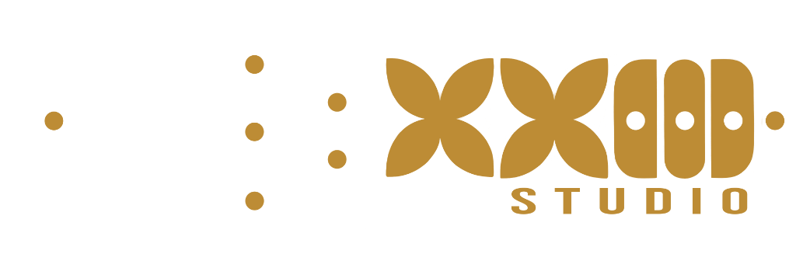

# Atlas XXIII — Comic Studio

<div align="center">
  
  <br /><br />
  <a href="https://comic.atlasxxiii.app"></a>
  
  
</div>

---

### Overview

**Atlas XXIII — Comic Studio** is an AI comic book authoring and sequential art suite engineered for story directors, illustrators, and independent graphic novelists. The official sequel to the engine behind the acclaimed graphic series *"Los Guiris Mutantes"*, Comic Studio combines sequential multi-panel page composition, character consistency labs, and dialogue lettering within the signature **Atlas XXIII Studio Plum & Deep Burgundy** interface.

- **Live Deployment**: [https://comic.atlasxxiii.app](https://comic.atlasxxiii.app) *(Mirror: [atlas-comic-studio.web.app](https://atlas-comic-studio.web.app))*
- **Repository**: [DannyV23/Atlas-XXIII---Comic-Studio](https://github.com/DannyV23/Atlas-XXIII---Comic-Studio)

---

### Key Capabilities

#### 1. Sequential Multi-Panel Page Layout Director
- **Dynamic Layout Grids**: Architect multi-panel pages with responsive gutters, custom aspect ratios, and custom reading flows (Western & Manga order).
- **Panel Regeneration**: Context-aware panel generation ensuring camera angle, lighting, and composition continuity across scenes.

#### 2. Character Consistency Labs
- **Character Armory**: Lock facial geometry, signature wardrobe, hairstyle, color palettes, and physique across an entire issue or series.
- **Reference Conditioning**: Ingest reference portraits to synthesize recurring protagonists and antagonists in diverse emotional states and combat poses.

#### 3. Dual Engine Generative Pipeline
- **Gemini 3.8 Flash**: Low-latency engine driving narrative script generation, prompt optimization, panel descriptions, and dialogue pacing.
- **Nano Banana 2.1**: Flagship visual generation delivering razor-sharp line art, cel-shading, dynamic comic inks, and print-grade 4K panel textures.

#### 4. Dialogue & Typographic Lettering Studio
- **Ballooning Engine**: Customizable speech bubbles, jagged scream balloons, organic thought clouds, and rectangular narrative caption boxes.
- **Sound Effects (SFX)**: Hand-lettered typographic sound effects with rotational controls, color strokes, and drop-shadow styling.

#### 5. CBS Project Archive (.cbs)
- **Universal Save / Restore**: Lossless local project serialization storing full book layouts, character reference sheets, prompts, and lettering configurations.
- **Zero Cloud Lock-In**: Complete offline file portability enabling instant restoration and collaboration sharing.

#### 6. High-Resolution Print Export
- **Production-Ready Output**: Direct export to high-resolution 4K PNG panels, complete page spreads, and bundled print-ready PDF / ZIP archives.

#### 7. Studio Diagnostics, Release Ledger & Localization
- **Error Logger & Diagnostics**: Built-in diagnostic modal capturing API errors, safety blocks, and stack traces with one-click copy.
- **Interactive Release Ledger (`v2.0.3`)**: Viewable version history and release notes directly from the app.
- **Bilingual UI (`EN` / `ES`) & API Guide**: Instant English/Spanish switching alongside an interactive Gemini API key setup and free-tier billing guide.

---

### Design System: Studio Plum & Deep Burgundy

Built in accordance with the official **Atlas XXIII Studio Plum & Deep Burgundy** design tokens:

| Token | Hex Value | Purpose |
| :--- | :--- | :--- |
| **Deep Canvas** | `#0D0509` / `#0E070C` | Base body background and ambient radial gradient anchor |
| **Sidebar & Glass Cards** | `#150711` | Frosted glass containers and control sidebar |
| **Structural Borders** | `#3D1629` | Hairline framing across cards, dividers, and dropdowns |
| **Primary Studio Bronze** | `#C68B59` | Brand insignia, active states, chevrons, and outlines |
| **Warm Metallic Bronze** | `#DF9E65` | Highlights, active tier badges, and status pills |
| **Signature Bronze Gradient** | `#B97743` → `#C98A55` → `#DF9D64` | Primary call-to-action buttons and active tabs |
| **Warm Ivory Text** | `#FAF5F0` | High-contrast headings and primary typography |
| **Muted Slate Mauve** | `#8A6D7B` / `#A88B97` | Helper text, metadata, and secondary labels |

---

### Tech Stack

- **Frontend**: [React 19](https://react.dev/), [TypeScript](https://www.typescriptlang.org/), [Tailwind CSS v4](https://tailwindcss.com/)
- **Build Tool**: [Vite](https://vitejs.dev/)
- **Animations & Motion**: [Motion](https://motion.dev/)
- **Export & Utilities**: [jsPDF](https://github.com/parallax/jsPDF), [JSZip](https://stuk.github.io/jszip/)
- **AI Models & SDK**: [Google Gen AI SDK](https://www.npmjs.com/package/@google/genai) (`@google/genai`) with Gemini 3.8 Flash & Nano Banana 2.1
- **Backend & Cloud**: [Firebase Hosting](https://firebase.google.com/products/hosting)

---

### Local Development

1. **Clone the repository**:
   ```bash
   git clone https://github.com/DannyV23/Atlas-XXIII---Comic-Studio.git
   cd Atlas-XXIII---Comic-Studio
   ```

2. **Install dependencies**:
   ```bash
   pnpm install
   ```

3. **Start local development server**:
   ```bash
   pnpm run dev
   ```

4. **Build production bundle**:
   ```bash
   pnpm run build
   ```

5. **Deploy to Firebase Hosting**:
   ```bash
   pnpm exec firebase deploy --only hosting
   ```

---

<div align="center">
  <p><b>Atlas XXIII Suite • <a href="https://atlasxxiii.app">atlasxxiii.app</a></b></p>
  <p>Created by Danny Vain · <a href="https://www.instagram.com/dannyvain/">instagram.com/dannyvain</a></p>
  <p><code>v2.0.3</code></p>
</div>
